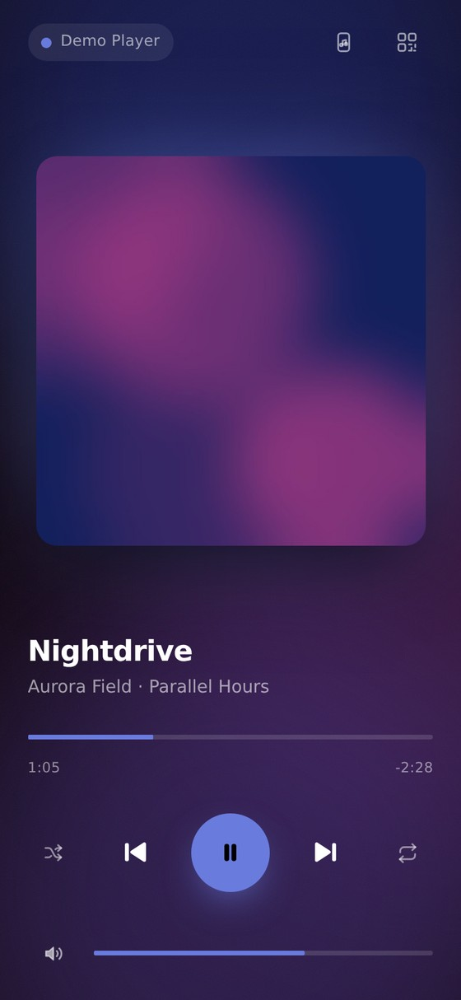
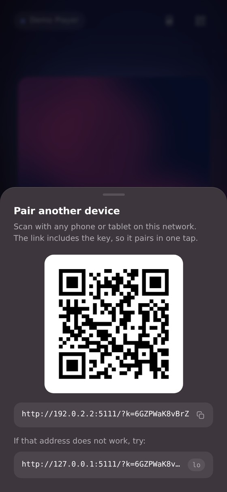
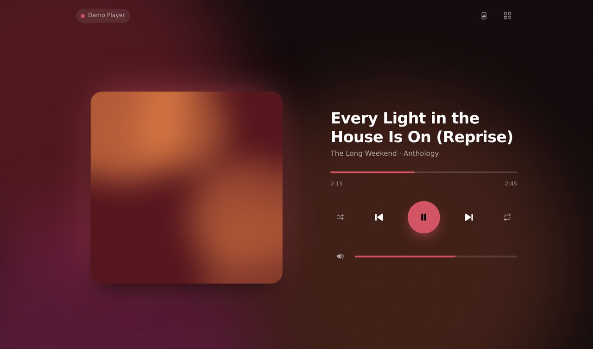

# WeRV

[](https://opensource.org/licenses/Apache-2.0)

## *Remote Media Control*

Control whatever is playing on your Windows PC from your phone, over your own Wi-Fi.
Play, pause, skip, scrub, change the volume, and see the cover art — without alt-tabbing
or getting up.

<p align="center">
  
  &nbsp;&nbsp;
  
</p>

<p align="center">
  
</p>

## Highlights

- **Scan and go.** A QR code is drawn in the console at startup. Scan it and you are in;
  the link carries the pairing key, so there is nothing to type.
- **Everything updates instantly.** The PC pushes changes to your phone as they happen,
  so the track, artwork and progress follow along on their own.
- **Real scrubbing and volume.** Drag to any point in the track, and set the system
  volume from the same screen.
- **It knows what the app can do.** Shuffle, repeat and seek light up only when the app
  playing actually supports them.
- **Pick your source.** Music in Spotify and a video in a browser tab at the same time?
  Tap the name at the top and choose which one the remote drives.
- **It looks like the music.** The interface takes its colours from the album art.
- **Control from the lock screen.** Turn it on with the phone button in the header and
  the PC's track — artwork, title, play/pause, skip and the scrubber — appears on your
  phone's lock screen like a local player, on iOS and Android.
- **Add it to your home screen** and it opens full-screen, like an app.

## Installation

WeRV runs on Windows 10 and 11.

### From source

```powershell
git clone https://github.com/Lord-More-Axe/WeRV-media-control
cd WeRV-media-control
pip install -r requirements.txt
python werv.py
```

### From a release

Download the latest [release](https://github.com/Lord-More-Axe/WeRV-media-control/releases),
extract it, and run `werv.exe`.

When the Windows firewall prompt appears, allow the app on **private** networks. You only
need to tick "public" if you are on a network Windows has classified that way — see
[Security](#security) before you do.

## Usage

1. Put some music or a video on, on the PC.
2. Run WeRV. It prints a QR code and an address:

   ```
     WeRV 1.0.0  --  remote media control

     ███████████████████████████████████
     ████ ▄▄▄▄▄ ██▀█ ▀█▀ ▄▄▀▄ █ ▄▄▄▄▄ ██
     ████ █   █ ████▀▀▀█▀▄▄▀▄▄█ █   █ ██
                    ... etc ...
     ████▄▄▄▄▄▄▄█▄█████▄▄█▄█▄▄█▄████▄███
     ███████████████████████████████████

     Scan the code, or open  http://192.168.1.24:5000/?k=Xq2p-7hFa9dK
   ```

3. Scan it with your phone's camera. Both devices need to be on the same network.

That is the whole setup. The pairing key is kept between runs, so a phone that has
scanned once keeps working after the PC restarts — you just open it.

To bring in another device later, tap the QR button in the top corner of the remote and
scan from there — you do not have to go back to the PC.

If the printed address does not work — a VPN or a virtual network adapter can push the
wrong one to the front — the pairing sheet lists the other addresses your PC has.

If the QR code is hard to scan because your terminal has a light background, run with
`--qr-light`.

### Lock-screen controls

Tap the phone button in the top corner of the remote to put the PC's playback on your
phone's lock screen. While it is on, the page quietly loops a silent track — that is
what earns a web page a place on the lock screen — and paints the real artwork, title
and transport over it, so you can pause and skip without unlocking the phone.

It is off by default because holding a spot on the lock screen means taking the phone's
audio focus: turning it on will pause anything the phone itself is playing. The setting
is remembered; after a reload, the first tap anywhere switches it back on (browsers
require a touch before a page may start audio).

## Configuration

```
python werv.py [options]

  --port PORT     port to listen on (default: 5000)
  --host HOST     interface to bind (default: all). Binding one interface also
                  limits the QR code and pairing links to that address
  --no-auth       skip pairing entirely; anyone on the network can control playback
  --new-key       issue a new pairing key, so every paired device must pair again
  --demo          run a simulated player, for trying the interface out
  --no-qr         do not draw a QR code in the console
  --qr-light      invert the console QR for light-background terminals
  --verbose, -v   log everything
```

`--demo` works on any operating system, so you can see the interface on a Mac or a Linux
box even though media control itself is Windows-only.

## Security

By default WeRV listens on every network interface, which is what lets your phone reach
it — but it also means everyone else on that network can reach it too. So it is paired
rather than open:

- A random key is embedded in the QR link. Devices trade it for a cookie on first
  visit; everything else is refused. The key is stored in your own profile
  (`%LOCALAPPDATA%\WeRV\pairing-key`, or `~/.config/werv/pairing-key`) so pairing
  survives a restart — run `--new-key` to issue a fresh one and unpair everything.
- Control requests must be same-origin `POST`s. A page on the internet cannot fire them
  at your PC, which the previous version allowed through any `` tag.
- Requests are only answered for local addresses, so a hostile site cannot point a
  domain it owns at your machine and talk to WeRV through your browser.
- No cover art or media metadata is written to disk, and nothing leaves your network.

`--no-auth` turns pairing off if you would rather not bother on a network you trust,
and `--host` narrows what WeRV listens on if you want it reachable from one interface
only.

## Troubleshooting

**The phone cannot connect.** Check both devices are on the same network — not one on
Wi-Fi and one on a guest network. VPNs are the usual culprit; disconnect and try again.
In Portmaster, make sure "block incoming connections" is off for WeRV.

**A phone that used to work now asks to pair again.** Someone ran `--new-key`, or the
key file was removed. Scan the code once more.

**Nothing shows up.** Start playback on the PC first. Anything that registers with
Windows works: Spotify, a browser tab, VLC, Telegram, a podcast app.

**The wrong app is being controlled.** Tap the app name at the top of the remote and pick
the right one.

**Some buttons are dimmed.** That app has told Windows it does not support them. Browser
tabs in particular often allow only play and pause.

**No volume slider.** `pycaw` is not installed — `pip install pycaw`. Everything else
keeps working without it.

**No lock-screen controls.** They have to be switched on with the phone button in the
header, and the browser must support the Media Session API (iOS 15+, any recent
Android Chrome). If the toggle will not stick, tap it once more — browsers demand a
fresh touch before a page may start audio.

## How it works

WeRV asks Windows about the media session itself, through the same interface behind the
volume-key overlay, rather than faking keyboard presses. That is where the artwork,
capabilities, position and source list all come from, and it means commands go to the app
you chose instead of to whatever happens to be listening.

```
werv/
  __main__.py   command line, startup, the console QR code
  server.py     HTTP: pages, the event stream, the command endpoint
  hub.py        watches the player and pushes changes to every device
  media.py      the shape of a player, independent of the OS
  windows.py    Windows media sessions and system volume
  demo.py       a simulated player, so the interface runs anywhere
  art.py        cover art cache and the colours drawn from it
  net.py        finding a reachable address, and the QR code
  pairing.py    the pairing key, and keeping it between runs
```

## Development

```bash
pip install -r requirements-dev.txt
python -m pytest            # the suite runs on any OS
python werv.py --demo
```

The Windows backend is covered by tests that run against a stand-in for the Windows APIs,
built from the published type signatures — so its behaviour is checked even on machines
that cannot run it.

## Credits

The original interface was based on
[this project](https://github.com/sayantanm19/js-music-player).

## License

Licensed under the [Apache License 2.0](LICENSE).
